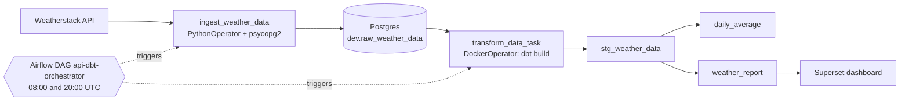

# Weather ELT Pipeline

An Airflow-orchestrated ELT pipeline that pulls current weather from the Weatherstack API into Postgres twice a day, transforms it with dbt, and reports it in Apache Superset. Everything runs under Docker Compose.

Built by following the YouTube tutorial [How to build an automated data pipeline using Airflow, dbt, Postgres, and Superset](https://www.youtube.com/watch?v=vMgFadPxOLk), with the changes listed under [Differences from the tutorial](#differences-from-the-tutorial).

## Architecture



## Stack

| Component | Version / image | Role |
|---|---|---|
| PostgreSQL | `postgres:18.6-bookworm` | Raw and transformed data, Airflow and Superset metadata |
| Apache Airflow | `apache/airflow:3.3.2` | Schedules and runs the DAG (standalone mode) |
| dbt (postgres adapter) | `ghcr.io/dbt-labs/dbt-postgres:1.9.latest` | SQL transformations and tests |
| Apache Superset | `apache/superset:3.0.0-py310` | Dashboards |
| Redis | `redis:7` | Superset cache |
| Weatherstack | REST API (`/current`) | Data source |

## Project structure

```
weather-data-project/
├── .env.example          # Postgres, Weatherstack, dbt path and Docker GID settings
├── .gitignore
├── docker-compose.yaml   # All services and the shared network
├── .vscode/              # Editor settings
├── airflow/
│   └── dags/             # orchestrator.py: the api-dbt-orchestrator DAG
├── api-request/          # api_request.py (API client), insert_records.py (DB load)
├── dbt/
│   ├── profiles.yml      # dbt connection profile (reads env vars)
│   └── my_project/       # dbt project: models/, tests/, macros/, seeds/, ...
├── docker/               # Superset env template, config, and init scripts
└── postgres/             # airflow_init.sql, superset_init.sql
```

## Quickstart

**Prerequisites:** Docker with Compose v2, on Linux or WSL2. You also need a Weatherstack API key only if you turn off mock mode.

```bash
cp .env.example .env
cp docker/.env.example docker/.env
```

Fill in the values:

| File | Variable | Value |
|---|---|---|
| `.env` | `DBT_HOST_PATH` | Absolute host path to this repo's `dbt` folder (e.g. `readlink -f dbt`). The Airflow DockerOperator mounts it through the host Docker daemon, so it must be a host path. |
| `.env` | `DOCKER_GID` | Group ID of the Docker socket: `stat -c %g /var/run/docker.sock` |
| `.env` | `WEATHERSTACK_API_KEY` | Your Weatherstack key (not needed while `USE_MOCK_API=true`) |
| `docker/.env` | `SUPERSET_SECRET_KEY` | Output of `openssl rand -base64 42` |

Then start the stack:

```bash
docker compose up -d
```

## Services

| Service | Address | Login |
|---|---|---|
| Airflow | http://localhost:8081 | User `admin`. The generated password is in the file printed by `docker exec airflow_container cat /opt/airflow/simple_auth_manager_passwords.json.generated` |
| Superset | http://localhost:8089 | `admin` / `admin`. Change this password after first login. |
| Postgres | `localhost:5000` | `DB_USER` / `DB_PASSWORD` from `.env`, database `DB_NAME` (`db` by default) |

To print every login in one place (the Airflow password is read from the running container), run `./scripts/show_credentials.sh`. Save it locally with `./scripts/show_credentials.sh > credentials.local.md`; that file is gitignored.

## Using it

1. Open Airflow and unpause the DAG `api-dbt-orchestrator`. It runs twice a day at 08:00 and 20:00 UTC (no catchup). You can also trigger it manually.
2. Choose the data source with `USE_MOCK_API` in `.env`:
   - `true` (default): uses a built-in sample response. The sample has a fixed timestamp, so repeated runs insert duplicate observations, which `stg_weather_data` removes.
   - `false`: calls the live Weatherstack API for `WEATHER_CITY` (default `New York`).
   - The free Weatherstack tier has a small monthly quota. The twice-daily schedule uses about 60 calls per month; every manual trigger uses one more. After changing `.env`, run `docker compose up -d` to apply it.
3. Optional: load test history so the dashboard has data from day one. This inserts two synthetic observations per day (08:00 and 20:00 New York time) for the last 30 days, without calling the API. Then trigger the DAG once to rebuild the dbt models.
   ```bash
   docker exec airflow_container python /opt/airflow/api-request/seed_test_data.py --days 30
   ```
4. Set up Superset once the DAG has run at least once (so the dbt tables exist). This registers the `weather_db` connection, the datasets `weather_report`, `daily_average` and `stg_weather_data`, three charts, and a **Weather Dashboard** that auto-refreshes every 5 minutes. It is safe to re-run.
   ```bash
   docker exec superset_app python /app/docker/superset_setup.py
   ```
   Then open http://localhost:8089/superset/dashboard/weather/. If you changed `DB_USER`/`DB_PASSWORD` in `.env`, pass the connection string with `docker exec -e WEATHER_DB_URI=postgresql://USER:PASSWORD@db:5432/db superset_app python /app/docker/superset_setup.py`.

   To do it by hand instead: Settings → Database Connections → add PostgreSQL with host `db`, port `5432`, database `db` and the credentials from `.env`; then add `dev.weather_report` as a dataset and build charts from it.

## dbt models

| Layer | Model | Materialization | Purpose |
|---|---|---|---|
| Staging | `stg_weather_data` | table | Deduplicates raw rows to one row per city and observation time (earliest `inserted_at` kept) and adds `inserted_at_local`. Reads source `dev.raw_weather_data`. |
| Mart | `daily_average` | table | Average temperature and wind speed per city per calendar day. |
| Mart | `weather_report` | table | Observation-level rows for reporting. This is the dataset used in Superset. |

**Tests** (in `dbt/my_project/models/schema.yml`): 8 generic tests. `stg_weather_data.id` is unique and not null. `city` and `weather_time_local` are not null in staging and in `weather_report`. `city` and `date` are not null in `daily_average`.

The Airflow task runs `dbt build`, which runs the models and their tests together. A failing test fails the task.

## Differences from the tutorial

- Secrets and settings live in `.env` and `docker/.env`, not in the compose file.
- One combined DAG runs ingest and transform in sequence, instead of separate DAGs.
- The DAG runs `dbt build` (models plus tests) and the project includes dbt tests.
- The DockerOperator mount uses a configurable host path (`DBT_HOST_PATH`), and the Docker network has a fixed name (`weather_network`).
- Image tags are pinned, except the dbt image, which uses the floating `1.9.latest` tag.
- Superset is exposed on port 8089.
- Superset example data is disabled (`SUPERSET_LOAD_EXAMPLES=no`).

## Troubleshooting

- **`permission denied` on `/var/run/docker.sock`** (Airflow DockerOperator): set `DOCKER_GID` in `.env` to the value of `stat -c %g /var/run/docker.sock`, then run `docker compose up -d` again.
- **Init SQL scripts did not run** (`airflow_init.sql`, `superset_init.sql`): Postgres runs these only when its data directory is empty. To reset, run `docker compose down -v`, then delete `postgres/data`. The directory is owned by root, so use `sudo rm -rf postgres/data`.
- **`superset_init` fails or exits with an error**: check its output with `docker logs superset_init`.
