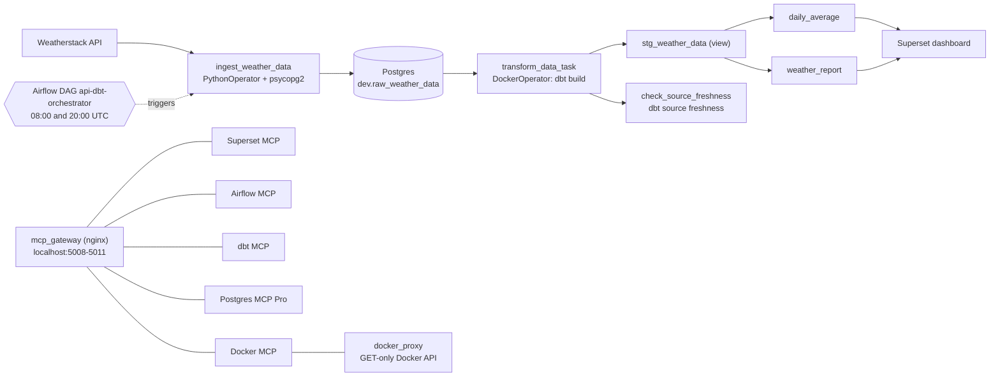

# Weather ELT Pipeline

[](https://github.com/henrymarinho90/weather-data-project/actions/workflows/ci.yml)

An Airflow-orchestrated ELT pipeline that pulls current weather from the Weatherstack API into Postgres twice a day, transforms and tests it with dbt, and reports it in Apache Superset. Five MCP servers let AI clients (Claude Code, Claude Desktop, ...) inspect every layer read-only. Everything runs under Docker Compose.

Built by following the YouTube tutorial [How to build an automated data pipeline using Airflow, dbt, Postgres, and Superset](https://www.youtube.com/watch?v=vMgFadPxOLk), with the changes listed under [Differences from the tutorial](#differences-from-the-tutorial).

## Architecture



## Stack

| Component | Image | Role |
|---|---|---|
| PostgreSQL | `postgres:18.6-bookworm` | Weather data, Airflow and Superset metadata |
| Apache Airflow | `apache/airflow:3.3.2` | Runs the DAG (standalone mode) |
| dbt (postgres adapter) | `ghcr.io/dbt-labs/dbt-postgres:1.9.0` (`DBT_IMAGE`) | Transformations and tests |
| Apache Superset | `weather-superset:6.1.0`, built from `apache/superset:6.1.0-py311` (`docker/Dockerfile`) | Dashboards and its MCP server |
| Redis | `redis:7.4.12` | Superset cache |
| Superset MCP | built into Superset 6.1 (`superset mcp run`) | Dashboards, charts, datasets, SQL |
| Airflow MCP | `weather-airflow-mcp:0.9.1` (community `airflow-mcp-server`, `airflow-mcp/`) | DAGs, runs, task logs (read-only) |
| dbt MCP | `weather-dbt-mcp:1.7.1` (community `dbt-core-mcp`, `dbt-mcp/`) | Models, lineage, queries, tests |
| Postgres MCP | `crystaldba/postgres-mcp:0.3.0` | Schema, restricted SQL, health, slow queries |
| Docker MCP | `weather-docker-mcp:1.0.0` (this repo, `docker-mcp/`) | Container status, health, logs, stats (read-only) |
| Docker API proxy | `tecnativa/docker-socket-proxy:v0.5.0` | GET-only Docker API for the Docker MCP |
| MCP gateway | `nginx:1.30.6-alpine` (`mcp-gateway/`) | Single localhost entry point with Host/Origin checks |

## Quickstart

**Prerequisites:** Docker with Compose v2.24+ on Linux, WSL2 or macOS (Docker Desktop), plus `make` and `python3` for the setup script. A Weatherstack API key is only needed when you turn off mock mode.

```bash
make init     # creates .env and docker/.env with random secrets and this machine's paths/ids
make up       # builds and starts everything
make seed     # optional: 30 days of synthetic history, no API calls
```

Then open Airflow, unpause `api-dbt-orchestrator` and trigger it once (it builds the dbt models), and register the Superset dashboard:

```bash
make superset-setup
make creds    # prints every login; `make creds > credentials.local.md` saves it (gitignored)
```

`make help` lists all targets. `scripts/init_env.sh` never overwrites existing values, so re-run `make init` after pulling a version that adds settings.

## Services

All ports are published on `127.0.0.1` only.

| Service | Address | Login |
|---|---|---|
| Airflow | http://localhost:8081 | `admin`, password generated by Airflow on first start (`make creds`) |
| Superset | http://localhost:8089 | `admin`, `ADMIN_PASSWORD` from `docker/.env` |
| Postgres | `localhost:5434` (`POSTGRES_HOST_PORT`) | See [Database roles](#database-roles) |
| Superset MCP | http://localhost:5008/mcp | No client auth |
| Airflow MCP | http://localhost:5009/mcp/ (trailing slash) | No client auth |
| dbt MCP | http://localhost:5010/mcp | No client auth |
| Postgres MCP | http://localhost:5011/sse (SSE) | No client auth |
| Docker MCP | http://localhost:5012/mcp | No client auth |

## Using it

1. **Data source:** `USE_MOCK_API` in `.env`. `true` (default) uses a built-in sample response stamped with the current New York time (fixed weather values, no API calls); `false` calls Weatherstack for `WEATHER_CITY`. The twice-daily schedule uses about 60 API calls a month, and each manual trigger one more. Apply `.env` changes with `make up`.
2. **DAG** `api-dbt-orchestrator`: `ingest_weather_data` → `transform_data_task` (`dbt build`: models plus tests) → `check_source_freshness` (fails if the newest observation is over 25 h old). Tasks retry once and time out after 10 minutes. When a task fails for good, `airflow/dags/alerting.py` posts to `ALERT_WEBHOOK_URL` (Slack or Discord incoming webhook) if set, otherwise it only logs.
3. **Dashboard:** `make superset-setup` creates the read-only `weather_db` connection, datasets for `weather_report` and `daily_average`, three charts and a **Weather Dashboard** (http://localhost:8089/superset/dashboard/weather/) that refreshes every 5 minutes. Re-running it updates everything in place.

## dbt models

| Layer | Model | Materialization | Grain / purpose |
|---|---|---|---|
| Staging | `stg_weather_data` | view | One row per city and UTC observation time. Adds `observed_at_utc` (local time minus `utc_offset`), casts the offset, keeps the earliest load of duplicate API responses. |
| Mart | `weather_report` | table | Observation-level reporting interface for Superset. |
| Mart | `daily_average` | table | One row per city and local date, with `n_observations` so partial days are visible, plus avg/min/max temperature and avg wind speed. |

**Tests** (`dbt build` runs them; a failure fails the task): grain uniqueness for all three models, `not_null` on keys, value ranges (temperature -60..60 °C, wind 0..400 km/h), accepted UTC offsets (warn), and a unit test for the dedup logic. **Source freshness** is measured on observation time, not load time, so a cached API response or mock mode is caught.

## AI access with MCP servers

The project [`.mcp.json`](.mcp.json) registers all five servers for Claude Code: start `claude` in the repo folder, approve them, check with `/mcp`. For Claude Desktop, add the URLs from [Services](#services) to `claude_desktop_config.json` (the Postgres one needs `"type": "sse"`).

| Server | What AI clients can do | Guard rails |
|---|---|---|
| **Superset** (built-in, [docs](https://superset.apache.org/admin-docs/configuration/mcp-server)) | List/inspect dashboards, charts and datasets, read chart data, create charts, run SQL. Tools beyond the first four are found via `search_tools` and run via `call_tool`. | Acts as Superset `admin` (auth off for local use), but SQL reaches Postgres as `weather_reader` and the connection disallows DML. |
| **Airflow** ([airflow-mcp-server](https://github.com/abhishekbhakat/airflow-mcp-server) 0.9.1) | 68 GET tools: DAGs, runs, task instances, logs, XComs, import errors. | `--safe` mode and an Airflow `viewer` user (`mcp`); connections, variables and config return 403. |
| **dbt** ([dbt-core-mcp](https://github.com/NiclasOlofsson/dbt-core-mcp) 1.7.1) | Project info, model and column lineage, impact analysis, compiled SQL, `{{ ref() }}` queries, running tests. | Safe mode disables build/run/seed/snapshot/deps; connects as `weather_reader`; the dbt project is mounted read-only with private in-memory `target/` and `logs/`. |
| **Docker** (this repo, `docker-mcp/server.py`) | `get_stack_health`, `list_containers`, `get_container_details`, `get_container_logs` (tail/since/contains), `get_container_stats`, `list_images`. | Only this compose project's containers; selected fields only (never `Env` or commands); logs pass through a secret-masking filter; the Docker API is reached through `docker_proxy` with `POST=0` (writes return 403) on an internal network no other container joins. |
| **Postgres** ([Postgres MCP Pro](https://github.com/crystaldba/postgres-mcp) 0.3.0) | Schemas, object details, SQL, explain plans, health checks, slowest queries (`pg_stat_statements`). | `--access-mode=restricted` plus `weather_reader`. Index simulation needs `hypopg`, which the official image lacks. |

Example prompts: *"Is the whole stack healthy? Show the last errors in the Airflow logs."*, *"Did the weather DAG's last run succeed?"*, *"Which models depend on stg_weather_data and do their tests pass?"*, *"What was the average temperature in New York last week?"*, *"Show the slowest queries."*

**Why a gateway:** none of the five servers validates the `Host`/`Origin` headers, so a malicious web page could reach them through DNS rebinding. `mcp_gateway` is their only published port and answers 421 for a foreign `Host` and 403 for a foreign `Origin`.

**Allowing writes** (an AI client can then change data or, via Airflow triggers, spend API calls): Airflow `AIRFLOW_MCP_ROLE=op` + `AIRFLOW_MCP_MODE=--unsafe`; dbt `DBT_MCP_MODE=full` + `DBT_MCP_DB_USER`/`DBT_MCP_DB_PASSWORD` set to the `DB_USER`/`DB_PASSWORD` values. Then `make up`.

## Operations

- **Restarts and limits:** every long-running service restarts unless stopped and has memory/CPU limits (`deploy.resources.limits`); one-shot jobs (`dbt`, `superset_init`) do not restart.
- **Backups:** `db_backup` writes `pg_dump` files of `db`, `airflow_db` and `superset_db` plus the roles (`globals.sql`) to `./backups/<UTC timestamp>/` every day at `BACKUP_HOUR_UTC` (and on start if the newest backup is over 24 h old), keeping `BACKUP_KEEP_DAYS` days. Files are `chmod 600`; `globals.sql` contains password hashes. `./backups` is on the same machine, so copy it elsewhere for real disaster recovery.
  ```bash
  make backup          # back up now
  make backup-verify   # restore the newest dump into a scratch DB and compare row counts
  make restore RUN=backups/20261105T020000Z DB=db   # replace a database (asks for confirmation)
  ```
- **Alerts:** set `ALERT_WEBHOOK_URL` in `.env` and run `make up`.

## Database roles

`postgres/init_roles.sh` creates them on a fresh volume (re-apply after changing passwords with `docker exec db bash /docker-entrypoint-initdb.d/init_roles.sh`):

| Role | Privileges | Used by |
|---|---|---|
| `postgres` (`POSTGRES_SUPERUSER`) | Superuser | Administration only |
| `db_user` (`DB_USER`) | Owns database `db` and schema `dev`, not a superuser | Ingest, dbt |
| `weather_reader` | `SELECT` on `dev` (including tables dbt recreates), read-only sessions, 30 s statement timeout, `pg_read_all_stats` | Superset charts, dbt MCP, Postgres MCP |
| `airflow` / `superset` | Own `airflow_db` / `superset_db` | Airflow / Superset metadata |

`CONNECT` and `TEMP` are revoked from `PUBLIC` on every database, and `pg_stat_statements.track_utility=off` keeps `ALTER ROLE ... PASSWORD` out of the query statistics.

## Development

```bash
python3 -m venv .venv && .venv/bin/pip install -r requirements-dev.txt
make lint     # ruff check + format check
make test     # pytest: ingest mapping, API client, test-data generator (no DB or network)
make dbt-build
```

CI (`.github/workflows/ci.yml`) has four jobs:

- **python:** ruff and pytest.
- **compose-and-dbt:** generates env files with `scripts/init_env.sh`, validates `docker compose config`, runs `dbt parse`.
- **security-scan:** Trivy on the repository (dependency vulnerabilities, committed secrets, Dockerfile/compose misconfigurations); fails on fixable HIGH/CRITICAL findings.
- **integration:** starts Postgres and Airflow, runs the whole DAG in mock mode, checks the marts have data, then takes a backup and runs the restore test.

Dependabot (`.github/dependabot.yml`) opens weekly grouped updates for actions, Python requirements, Dockerfiles and compose images; major versions of `mcp`/`fastmcp` are ignored because they break the MCP servers.

## Project structure

```
weather-data-project/
├── .env.example, Makefile, docker-compose.yaml, pyproject.toml, requirements-dev.txt
├── .github/workflows/ci.yml
├── .mcp.json             # MCP servers for Claude Code
├── airflow/
│   ├── dags/orchestrator.py   # the api-dbt-orchestrator DAG
│   ├── dags/alerting.py       # failure webhook alerts
│   └── seed_mcp_user.py       # sets the Airflow 'mcp' user's password
├── airflow-mcp/          # Airflow MCP image: Dockerfile, locked requirements, token-refresh entrypoint
├── backup/               # backup.sh (db_backup service), verify.sh (restore test)
├── api-request/          # api_request.py (API client), insert_records.py (load), seed_test_data.py
├── dbt/
│   ├── profiles.yml      # connection profile (env vars)
│   └── weather/          # dbt project: models/staging, models/marts, tests
├── dbt-mcp/              # dbt MCP image: Dockerfile, HTTP launcher
├── docker-mcp/           # read-only Docker MCP server: server.py, docker_helpers.py, locked requirements
├── docker/               # Superset: Dockerfile, env template, config, superset_setup.py
├── mcp-gateway/          # nginx config for the MCP gateway
├── postgres/init_roles.sh
├── scripts/              # init_env.sh, show_credentials.sh, restore_backup.sh
└── tests/                # pytest unit tests
```

## Differences from the tutorial

- Secrets live in gitignored `.env` files generated with random values; the compose file only references them.
- Least-privilege Postgres roles instead of one superuser for everything; all ports bound to localhost.
- One DAG runs ingest → `dbt build` → source freshness, with retries and timeouts.
- dbt project restructured (staging view, marts, grain/range/unit tests, freshness on observation time, UTC observation timestamps).
- Portable setup: `DBT_HOST_PATH`, uid/gid and Docker socket group detected by `make init`; fixed network name; one `DBT_IMAGE`; Postgres data in a named volume.
- Exact image tags; Superset upgraded from 3.0 to 6.1 for its MCP server; example data disabled.
- Five MCP servers (Superset, Airflow, dbt, Postgres, Docker) behind a gateway, plus CI, unit tests, ruff and a Makefile.

## Troubleshooting

- **`permission denied` on `/var/run/docker.sock`** (DockerOperator): `DOCKER_GID` in `.env` must match `stat -c %g /var/run/docker.sock` (macOS: `stat -f %g`; Docker Desktop: usually `0`). Then `make up`.
- **Roles or databases missing**: `init_roles.sh` runs only on an empty volume. Re-apply it with the command in [Database roles](#database-roles), or reset everything (deletes all data) with `docker compose down -v`.
- **Port already in use**: change `POSTGRES_HOST_PORT` in `.env` (or the published ports in `docker-compose.yaml`).
- **`superset_init` fails**: `docker logs superset_init`.
- **`superset_setup.py` login fails** after changing the admin password in the UI: `docker exec -e SUPERSET_ADMIN_PASSWORD=... superset_app python /app/docker/superset_setup.py`.
- **MCP client cannot connect**: `docker compose ps` (each MCP container should be healthy) and `docker logs <container>`. If `airflow_mcp` keeps printing `Waiting for Airflow login`, Airflow is still starting.
- **`check_source_freshness` fails**: the newest observation is over 25 h old, e.g. the DAG was paused or the API keeps returning a cached observation; check the latest `observed_at_utc`.
