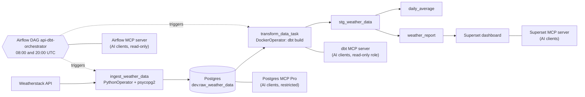

# Weather ELT Pipeline

An Airflow-orchestrated ELT pipeline that pulls current weather from the Weatherstack API into Postgres twice a day, transforms it with dbt, and reports it in Apache Superset. Everything runs under Docker Compose.

Built by following the YouTube tutorial [How to build an automated data pipeline using Airflow, dbt, Postgres, and Superset](https://www.youtube.com/watch?v=vMgFadPxOLk), with the changes listed under [Differences from the tutorial](#differences-from-the-tutorial).

## Architecture



## Stack

| Component | Version / image | Role |
|---|---|---|
| PostgreSQL | `postgres:18.6-bookworm` | Raw and transformed data, Airflow and Superset metadata |
| Apache Airflow | `apache/airflow:3.3.2` | Schedules and runs the DAG (standalone mode) |
| dbt (postgres adapter) | `ghcr.io/dbt-labs/dbt-postgres:1.9.latest` | SQL transformations and tests |
| Apache Superset | `weather-superset:6.1.0` (built from `apache/superset:6.1.0-py311` + `psycopg2-binary`, `fastmcp`; see `docker/Dockerfile`) | Dashboards and the MCP server |
| Redis | `redis:7` | Superset cache |
| Airflow MCP | `weather-airflow-mcp:0.9.1` (community `airflow-mcp-server`; see `airflow-mcp/`) | Read-only MCP access to Airflow |
| Postgres MCP | `crystaldba/postgres-mcp:0.3.0` | Restricted SQL, schema browsing, health checks, slow queries |
| dbt MCP | `weather-dbt-mcp:1.7.1` (community `dbt-core-mcp` on the dbt image; see `dbt-mcp/`) | MCP access to the dbt project |
| Weatherstack | REST API (`/current`) | Data source |

## Project structure

```
weather-data-project/
├── .env.example          # Postgres, Weatherstack, dbt path and Docker GID settings
├── .gitignore
├── .mcp.json            # MCP servers for Claude Code (superset, airflow, dbt)
├── docker-compose.yaml   # All services and the shared network
├── .vscode/              # Editor settings
├── airflow/
│   ├── dags/             # orchestrator.py: the api-dbt-orchestrator DAG
│   └── seed_mcp_user.py  # sets the Airflow 'mcp' user's password
├── airflow-mcp/          # Airflow MCP server image (Dockerfile, pinned requirements, entrypoint)
├── api-request/          # api_request.py (API client), insert_records.py (DB load)
├── dbt/
│   ├── profiles.yml      # dbt connection profile (reads env vars)
│   └── my_project/       # dbt project: models/, tests/, macros/, seeds/, ...
├── dbt-mcp/              # dbt MCP server image (Dockerfile, HTTP launcher)
├── docker/               # Superset Dockerfile, env template, config, setup script
├── postgres/             # airflow_init.sql, superset_init.sql, mcp_reader_init.sh (read-only MCP role)
└── scripts/              # show_credentials.sh
```

## Quickstart

**Prerequisites:** Docker with Compose v2, on Linux or WSL2. You also need a Weatherstack API key only if you turn off mock mode.

```bash
cp .env.example .env
cp docker/.env.example docker/.env
```

Fill in the values:

| File | Variable | Value |
|---|---|---|
| `.env` | `DBT_HOST_PATH` | Absolute host path to this repo's `dbt` folder (e.g. `readlink -f dbt`). The Airflow DockerOperator mounts it through the host Docker daemon, so it must be a host path. |
| `.env` | `DOCKER_GID` | Group ID of the Docker socket: `stat -c %g /var/run/docker.sock` |
| `.env` | `WEATHERSTACK_API_KEY` | Your Weatherstack key (not needed while `USE_MOCK_API=true`) |
| `docker/.env` | `SUPERSET_SECRET_KEY` | Output of `openssl rand -base64 42` |

Then start the stack:

```bash
docker compose up -d
```

## Services

| Service | Address | Login |
|---|---|---|
| Airflow | http://localhost:8081 | User `admin`. The generated password is in the file printed by `docker exec airflow_container cat /opt/airflow/simple_auth_manager_passwords.json.generated` |
| Superset | http://localhost:8089 | `admin` / `admin`. Change this password after first login. |
| Superset MCP | http://localhost:5008/mcp (localhost only) | No auth (local development); acts as the Superset `admin` user |
| dbt MCP | http://localhost:5010/mcp (localhost only) | No client auth; connects to Postgres as the read-only `mcp_reader` role (`MCP_READER_PASSWORD` in `.env`) |
| Postgres MCP | http://localhost:5011/sse (SSE, localhost only) | No client auth; restricted mode, connects as `mcp_reader` |
| Airflow MCP | http://localhost:5009/mcp/ (localhost only) | No client auth; logs into Airflow as the read-only `mcp` user (`AIRFLOW_MCP_PASSWORD` in `.env`) |
| Postgres | `localhost:5000` | `DB_USER` / `DB_PASSWORD` from `.env`, database `DB_NAME` (`db` by default) |

To print every login in one place (the Airflow password is read from the running container), run `./scripts/show_credentials.sh`. Save it locally with `./scripts/show_credentials.sh > credentials.local.md`; that file is gitignored.

## Using it

1. Open Airflow and unpause the DAG `api-dbt-orchestrator`. It runs twice a day at 08:00 and 20:00 UTC (no catchup). You can also trigger it manually.
2. Choose the data source with `USE_MOCK_API` in `.env`:
   - `true` (default): uses a built-in sample response. The sample has a fixed timestamp, so repeated runs insert duplicate observations, which `stg_weather_data` removes.
   - `false`: calls the live Weatherstack API for `WEATHER_CITY` (default `New York`).
   - The free Weatherstack tier has a small monthly quota. The twice-daily schedule uses about 60 calls per month; every manual trigger uses one more. After changing `.env`, run `docker compose up -d` to apply it.
3. Optional: load test history so the dashboard has data from day one. This inserts two synthetic observations per day (08:00 and 20:00 New York time) for the last 30 days, without calling the API. Then trigger the DAG once to rebuild the dbt models.
   ```bash
   docker exec airflow_container python /opt/airflow/api-request/seed_test_data.py --days 30
   ```
4. Set up Superset once the DAG has run at least once (so the dbt tables exist). This registers the `weather_db` connection, the datasets `weather_report`, `daily_average` and `stg_weather_data`, three charts, and a **Weather Dashboard** that auto-refreshes every 5 minutes. It is safe to re-run.
   ```bash
   docker exec superset_app python /app/docker/superset_setup.py
   ```
   Then open http://localhost:8089/superset/dashboard/weather/. If you changed `DB_USER`/`DB_PASSWORD` in `.env`, pass the connection string with `docker exec -e WEATHER_DB_URI=postgresql://USER:PASSWORD@db:5432/db superset_app python /app/docker/superset_setup.py`.

   To do it by hand instead: Settings → Database Connections → add PostgreSQL with host `db`, port `5432`, database `db` and the credentials from `.env`; then add `dev.weather_report` as a dataset and build charts from it.

## AI access with MCP servers

### Superset MCP server

The `superset_mcp` service runs Superset's built-in [MCP server](https://superset.apache.org/admin-docs/configuration/mcp-server) (`superset mcp run`) at `http://localhost:5008/mcp` (Streamable HTTP). AI clients can use it to list and inspect dashboards, charts and datasets, read chart data, run SQL and create charts or dashboards.

- **Claude Code:** this repo ships a project-scoped [`.mcp.json`](.mcp.json). Start `claude` in the repo folder and approve the `superset` server when prompted; check it with `/mcp`.
- **Claude Desktop:** add to `claude_desktop_config.json` and restart the app:
  ```json
  { "mcpServers": { "superset": { "url": "http://localhost:5008/mcp" } } }
  ```
- **Quick check:**
  ```bash
  curl -s -X POST http://localhost:5008/mcp -H 'Content-Type: application/json' \
    -H 'Accept: application/json, text/event-stream' \
    -d '{"jsonrpc":"2.0","id":1,"method":"tools/call","params":{"name":"health_check","arguments":{}}}'
  ```

The server lists a few tools up front (`health_check`, `get_instance_info`, `search_tools`, `call_tool`); the rest (`list_dashboards`, `get_chart_data`, `generate_chart`, `execute_sql`, ...) are found with `search_tools` and run through `call_tool`. Try asking your client: *"Using Superset, what was the average temperature in New York last week?"*

**Security:** authentication is off (`MCP_AUTH_ENABLED = False` in `docker/superset_config_docker.py`) and every request runs as `admin`, so the port is bound to `127.0.0.1`. Before exposing it anywhere else, enable JWT auth as described in the Superset docs, and consider `MCP_DISABLED_TOOLS = {"execute_sql"}`.

### Airflow MCP server

Airflow does not ship its own MCP server (the `common-ai` provider's "MCP connection" is the opposite direction: it lets Airflow tasks *call* MCP servers). The `airflow_mcp` service runs the community [airflow-mcp-server](https://github.com/abhishekbhakat/airflow-mcp-server) 0.9.1 (MIT) for Airflow 3 at `http://localhost:5009/mcp/` (keep the trailing slash).

- **Read-only by default:** it runs with `--safe` (GET tools only, 68 tools: DAGs, runs, task instances, logs, XComs, assets, import errors...) and logs into Airflow as a dedicated `mcp` user with the `viewer` role, so connections, variables and config return 403.
- **Login:** `airflow/seed_mcp_user.py` gives the `mcp` user the password from `AIRFLOW_MCP_PASSWORD` before Airflow starts. `airflow-mcp/entrypoint.sh` exchanges it for a JWT at `/auth/token` and restarts the server every 23 h, before the 24 h token expires.
- **Pinned dependencies:** `airflow-mcp/requirements.txt` is exported from the package's own `uv.lock`; newer `mcp`/`pydantic` releases break 0.9.1. The Dockerfile also patches one line so JSON results are sent as text too (see the comment there).
- **Allowing writes** (trigger, pause, clear DAG runs): set `AIRFLOW_MCP_ROLE=op` and `AIRFLOW_MCP_MODE=--unsafe` in `.env`, then `docker compose up -d af airflow_mcp`. Every manual trigger spends a Weatherstack API call.
- **Clients:** the project [`.mcp.json`](.mcp.json) registers it as `airflow` for Claude Code. For Claude Desktop use `{ "mcpServers": { "airflow": { "url": "http://localhost:5009/mcp/" } } }`. Try: *"Did the weather DAG's last run succeed, and when is the next one?"*

### dbt MCP server

The `dbt_mcp` service runs the community [dbt-core-mcp](https://github.com/NiclasOlofsson/dbt-core-mcp) 1.7.1 (MIT) at `http://localhost:5010/mcp`, so AI clients can see the transformation layer: models, sources, tests, model- and column-level lineage, impact analysis, compiled SQL, ad-hoc queries with `{{ ref() }}`/`{{ source() }}`, and running tests.

- **Same dbt as Airflow:** `dbt-mcp/Dockerfile` installs it into the `dbt-postgres:1.9` image the DAG uses (it runs dbt with its own interpreter), and `pip check` fails the build if that breaks a dbt requirement.
- **HTTP instead of stdio:** the package only ships a stdio entrypoint; `dbt-mcp/server.py` serves the same tools over Streamable HTTP so it can run in compose like the other MCP servers.
- **Read-only by default** (`DBT_MCP_MODE=safe`): `build_models`, `run_models`, `load_seeds`, `snapshot_models` and `install_deps` are disabled. `query_database` sends raw SQL to Postgres, so the service connects as `mcp_reader`, a `SELECT`-only role whose sessions are read-only (`postgres/mcp_reader_init.sh`); `drop table ...; commit` fails with *cannot execute DROP TABLE in a read-only transaction*.
- **No clashes with the DAG:** its `target/` and `logs/` are private in-memory folders, so MCP-triggered dbt commands never overwrite the artifacts of Airflow's scheduled `dbt build`.
- **Allowing builds:** set `DBT_MCP_MODE=full` and uncomment `DBT_MCP_DB_USER`/`DBT_MCP_DB_PASSWORD` in `.env` with the `DB_USER`/`DB_PASSWORD` values, then `docker compose up -d dbt_mcp`.
- **Clients:** registered as `dbt` in [`.mcp.json`](.mcp.json). Try: *"Which dbt models and tests depend on stg_weather_data, and do they pass?"*

### Postgres MCP Pro

The `postgres_mcp` service runs [Postgres MCP Pro](https://github.com/crystaldba/postgres-mcp) 0.3.0 (MIT, official image `crystaldba/postgres-mcp`) at `http://localhost:5011/sse`. Release 0.3.0 speaks stdio and **SSE** only, so clients connect with `"type": "sse"`.

- **Tools:** `list_schemas`, `list_objects`, `get_object_details`, `execute_sql`, `explain_query`, `analyze_db_health` (indexes, connections, vacuum, buffer cache...), `get_top_queries`, and index advice (`analyze_query_indexes`, `analyze_workload_indexes`).
- **Two read-only layers:** `--access-mode=restricted` rejects anything but read-only SQL before it is sent (`drop table ...` returns *Error validating query*), and the connection uses the `mcp_reader` role, whose sessions are read-only anyway.
- **Slow queries:** Postgres starts with `shared_preload_libraries=pg_stat_statements` and `mcp_reader_init.sh` creates the extension and grants `pg_read_all_stats`.
- **Not enabled:** the hypothetical-index simulation needs the `hypopg` extension, which the official Postgres image does not ship.
- **Clients:** registered as `postgres` in [`.mcp.json`](.mcp.json). For Claude Desktop: `{ "mcpServers": { "postgres": { "type": "sse", "url": "http://localhost:5011/sse" } } }`. Try: *"Check the database health and show the slowest queries."*

## dbt models

| Layer | Model | Materialization | Purpose |
|---|---|---|---|
| Staging | `stg_weather_data` | table | Deduplicates raw rows to one row per city and observation time (earliest `inserted_at` kept) and adds `inserted_at_local`. Reads source `dev.raw_weather_data`. |
| Mart | `daily_average` | table | Average temperature and wind speed per city per calendar day. |
| Mart | `weather_report` | table | Observation-level rows for reporting. This is the dataset used in Superset. |

**Tests** (in `dbt/my_project/models/schema.yml`): 8 generic tests. `stg_weather_data.id` is unique and not null. `city` and `weather_time_local` are not null in staging and in `weather_report`. `city` and `date` are not null in `daily_average`.

The Airflow task runs `dbt build`, which runs the models and their tests together. A failing test fails the task.

## Differences from the tutorial

- Secrets and settings live in `.env` and `docker/.env`, not in the compose file.
- One combined DAG runs ingest and transform in sequence, instead of separate DAGs.
- The DAG runs `dbt build` (models plus tests) and the project includes dbt tests.
- The DockerOperator mount uses a configurable host path (`DBT_HOST_PATH`), and the Docker network has a fixed name (`weather_network`).
- Image tags are pinned, except the dbt image, which uses the floating `1.9.latest` tag.
- Superset is exposed on port 8089.
- A read-only Airflow MCP server (community package) is added for AI clients.
- A dbt MCP server (community package) is added, connected through a read-only Postgres role.
- Postgres MCP Pro is added in restricted mode, and Postgres preloads `pg_stat_statements`.
- Superset is upgraded from 3.0 to 6.1 (custom image with the Postgres driver and `fastmcp`) to add the built-in MCP server.
- Superset example data is disabled (`SUPERSET_LOAD_EXAMPLES=no`).

## Troubleshooting

- **`permission denied` on `/var/run/docker.sock`** (Airflow DockerOperator): set `DOCKER_GID` in `.env` to the value of `stat -c %g /var/run/docker.sock`, then run `docker compose up -d` again.
- **Init SQL scripts did not run** (`airflow_init.sql`, `superset_init.sql`): Postgres runs these only when its data directory is empty. To reset, run `docker compose down -v`, then delete `postgres/data`. The directory is owned by root, so use `sudo rm -rf postgres/data`.
- **`superset_init` fails or exits with an error**: check its output with `docker logs superset_init`.
- **`PermissionError` under `/app/superset_home`** after upgrading from the Superset 3.0 setup (which ran as root): fix the volume owner with `docker run --rm --user root --entrypoint chown -v weather-data-project_superset_home:/h weather-superset:6.1.0 -R superset:superset /h`, then `docker compose restart superset superset_mcp`.
- **`mcp_reader` role missing** (dbt MCP tools fail with an authentication error on an existing database): run `docker exec db bash /docker-entrypoint-initdb.d/mcp_reader_init.sh` once.
- **MCP client cannot connect**: check `docker logs superset_mcp` / `docker logs airflow_mcp` / `docker logs dbt_mcp` / `docker logs postgres_mcp`; each must print `Uvicorn running on http://0.0.0.0:5008` / `:5009`. If `airflow_mcp` keeps printing `Waiting for Airflow login`, Airflow is still starting or `AIRFLOW_MCP_PASSWORD` is missing from `.env` (recreate `af` after adding it).
